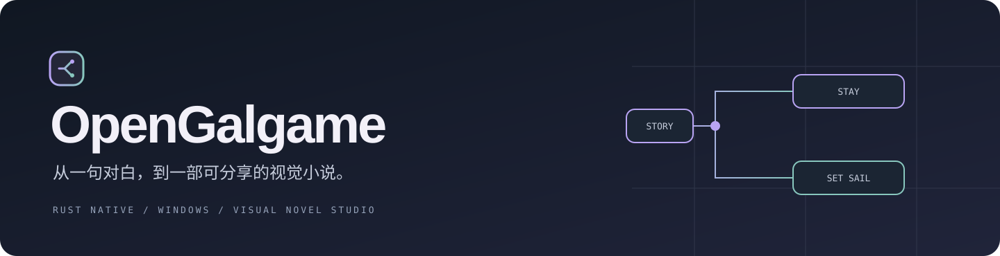
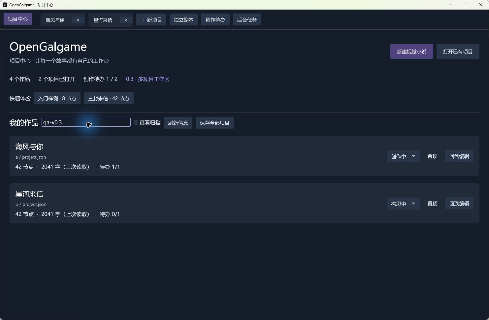
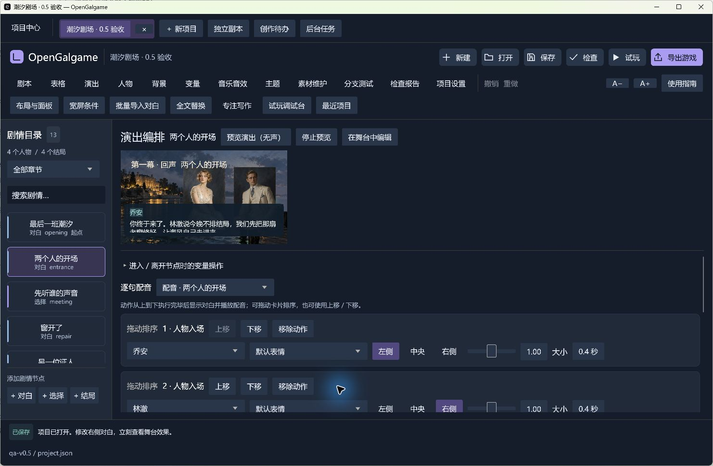
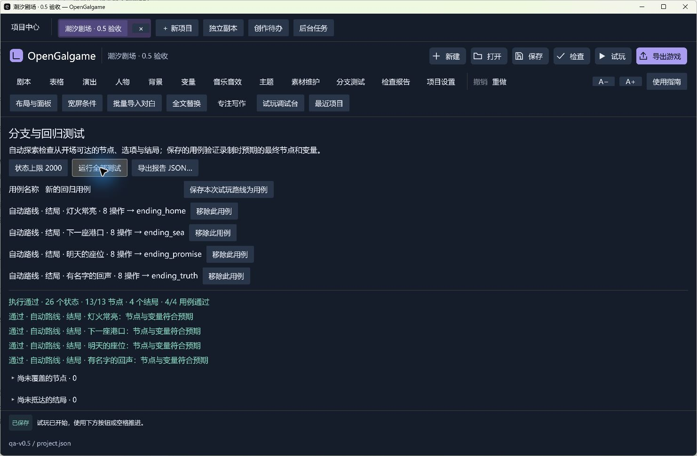
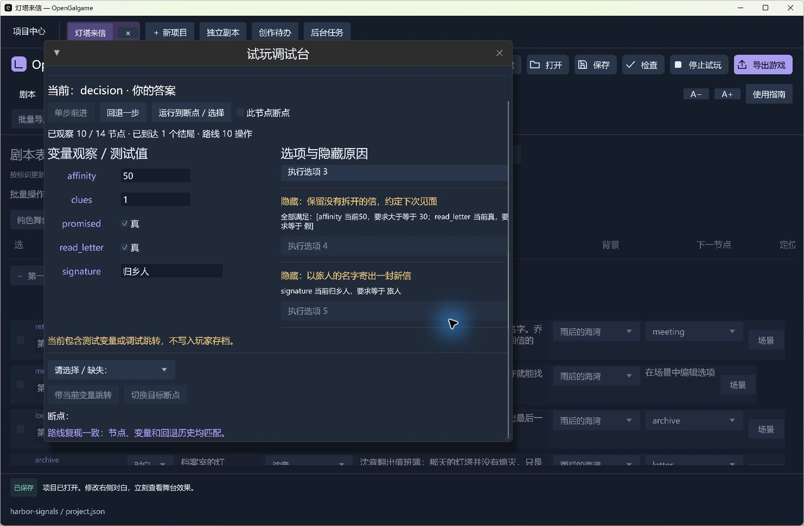
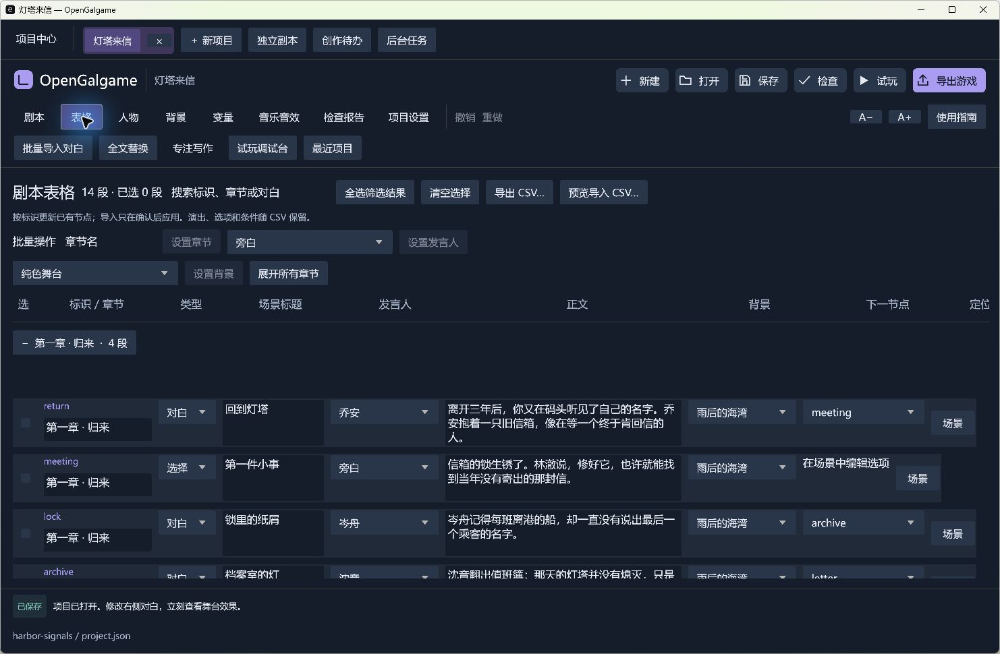
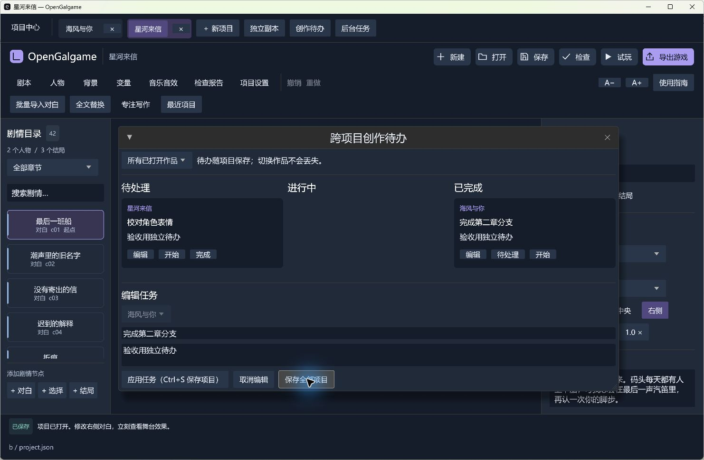
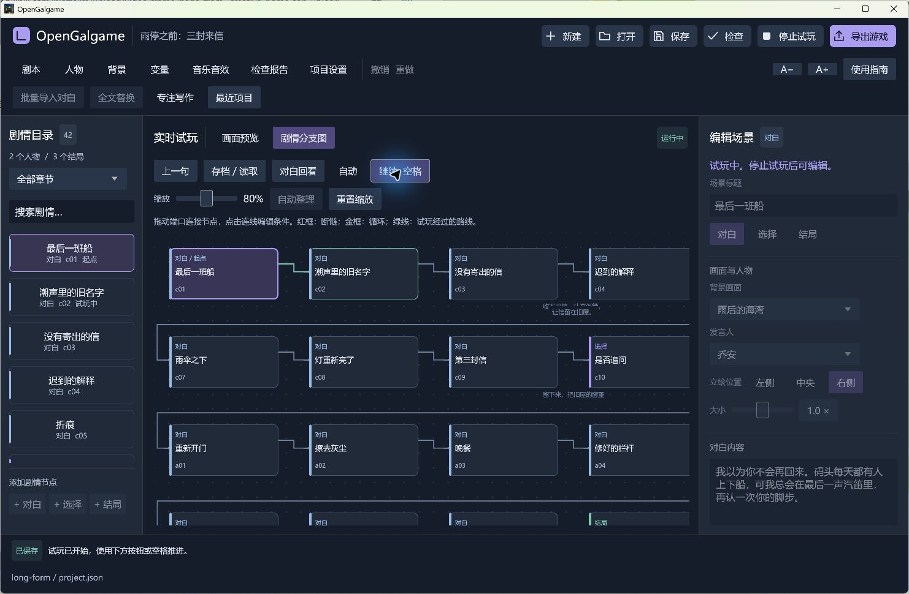
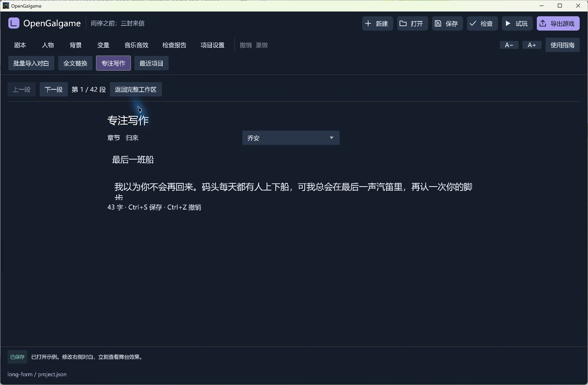
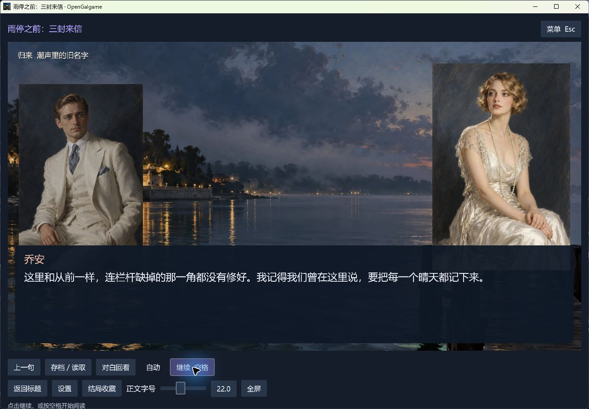

<p align="center">
  
</p>

<p align="center">
  <a href="https://github.com/eveque-dev/opengalgame/releases/latest"></a>
  <a href="https://github.com/eveque-dev/opengalgame/actions/workflows/windows.yml"></a>
  
  <a href="LICENSE"></a>
</p>

<p align="center">
  <strong>写下对白。连接选择。让故事真正运行。</strong><br>
  Rust 原生视觉小说引擎与可视化编辑器，为 Windows 创作者提供从剧本到独立游戏的完整工作流。
</p>

<p align="center">
  <a href="https://github.com/eveque-dev/opengalgame/releases/download/v0.5.1/opengalgame-v0.5.1-windows-x64.zip"><strong>下载编辑器</strong></a> ·
  <a href="docs/guide.zh-CN.md">使用指南</a> ·
  <a href="examples/long-form/project.json">查看示例剧本</a> ·
  <a href="docs/architecture.md">引擎架构</a>
</p>

---



### 给对白一个舞台

0.5 把人物进出场、移动缩放、表情、等待和背景切换编成顺序动作。拖动排序，调整时长，立即预览；逐句配音和独立环境音把同一段剧本带进实际演出。节点进入／离开操作随状态保存，回退与读档不重复累加变量。



### 让作品拥有自己的界面

调整对话框、姓名框、选项、字体、标题菜单与存档页，使用主题预设或导入自己的字体。编辑工作台也可以记住面板和列宽；表格支持键盘连续编辑、跨单元格复制粘贴，复杂条件可在宽屏窗口中展开。


### 每次修改，都有可重跑的依据

后台探索节点、选择和结局，定位尚未覆盖的分支，把自动结局路线或手动试玩记录保存成用例。下一次修改后重跑，核对最终节点和变量。素材维护支持更名同步引用、缺失文件预览修复，并在导出前列出素材体积与未使用文件。详见 [0.5 演出与制作指南](docs/production-v5.md)。



### 写出分支，也看懂分支

0.4 把好感度、线索和文本状态带入同一套可视化逻辑：布尔、整数、文本变量，嵌套“并且 / 或者”，顺序赋值与数值加减。试玩调试台逐项解释隐藏选项，观察测试值，在断点停下，再把这条路线录制、导出和复现。



### 把整章对白，放在同一张表里

连续编辑发言人、章节、正文、背景和跳转，多选批量调整，折叠章节，或导出 UTF-8 CSV 交给共同创作者。导入先预览和校验，再按稳定节点标识更新，保留演出、条件与选项。详见 [0.4 创作与调试指南](docs/authoring-v4.md)。



### 每个故事，都有自己的工作台

同时打开多部作品，切换时保留各自的未保存内容、撤销记录与试玩进度。项目中心整理作品阶段、置顶与归档；跨项目待办记录下一步要完成的对白、素材和分支。导出进入后台队列，创作可以继续。



### 把创作留在画面里

OpenGalgame 把人物、背景、对白和选择放在同一个工作区。你可以逐段写作，也可以整段导入剧本；在分支图里连接选择，在舞台上立即查看演出。项目可离线编辑，导出的游戏可以独立运行。

| 写故事 | 组织分支 | 完成演出 |
| :--- | :--- | :--- |
| 批量对白导入、章节筛选、全文查找替换、专注写作 | 端口拖线、条件选项、布尔变量、断链与循环提示 | 多人物同屏、表情组、立绘布局、淡入淡出与滑入 |
| **管理素材** | **随时试玩** | **交付作品** |
| 背景缩略图、人物标签、引用计数、替换与移除提示 | 编辑与成品共用舞台和运行内核，路线高亮、回退与变量恢复 | 标题菜单、音乐音效、截图存档、结局收藏、自定义图标 |

### 看清每一次选择



连线决定去向，条件决定哪些选择会出现。试玩时，分支图保留当前路线，方便核对剧情；检查报告会定位缺失素材、断开的目标、不可达节点和条件导致的死路。

### 写作时，留一点安静



专注模式隐藏左右面板，保留章节、发言人和正文。Ctrl+S 正式保存，Ctrl+Z 撤销；每 30 秒的独立恢复副本，为意外退出后的继续写作保留机会。

### 下载，解压，开始创作

前往 **[Releases](https://github.com/eveque-dev/opengalgame/releases/latest)**，选择适合你的文件：

| 文件 | 用途 |
| :--- | :--- |
| `opengalgame-v0.5.1-windows-x64.zip` | **推荐。** 便携编辑器，附完整样例和许可文件；解压后双击 `opengalgame.exe` |
| `tidal-stage-v0.5.1-windows-x64.zip` | 新版《潮汐剧场》四结局演出样片，附逐句配音和回归用例 |
| `harbor-signals-v0.5.1-windows-x64.zip` | 新版《灯塔来信》五结局样例，展示整数、文本与复合条件 |
| `three-letters-v0.5.1-windows-x64.zip` | 已导出的三结局游戏，解压后双击 `Game.exe` 体验 |
| `opengalgame-v0.5.1-source.zip` | 源码、锁定依赖、样例、测试与打包工具 |
| `opengalgame.exe` | 单文件编辑器，双击进入项目中心，可直接新建空白故事或双结局模板 |

玩家和便携版使用者无需安装 Rust、Python 或 WebView。目标平台为 **Windows 10/11 x64**，需要正常的 OpenGL 3.3 图形驱动。

```text
新建项目 → 导入人物与背景 → 编写对白 → 连接选择 → 试玩与检查 → 导出游戏
```

分享时发送整个导出目录，保留 `Game.exe`、`game.json`、`assets/` 与许可文件。详细操作见 [中文使用指南](docs/guide.zh-CN.md)。

### 从开场，走向三种明天



内附原创验收故事 **《雨停之前：三封来信》**：42 个节点、3 个结局、10 条完整选择路径。留下、远行，或追问一封信背后的真相，用实际故事检验条件分支、变量和存档。

新增 **《潮汐剧场》**：13 个节点、4 个结局、9 条完整路径、13 段中文演示配音与 4 个回归用例，展示顺序演出、多人舞台、环境音和节点操作。

**《灯塔来信》**：三章、四位角色、五个结局、十二条完整选择路径，验证数值、文本和复合条件。四位角色复用两张演示立绘，可替换。

另有 8 节点入门样例。示例表情组复用默认立绘，可导入自己的表情图片替换；音乐与提示音为程序合成，《潮汐剧场》配音由 Windows 本地语音合成生成，音频随包提供。

### 一个可以读懂、修改的内核

OpenGalgame 使用 **Rust + egui/eframe** 构建原生桌面界面。项目以 UTF-8 JSON 保存，剧情、运行、编辑和导出各有明确的模块边界。

```text
人物 / 背景 / 对白 / 选择
           │
    可视化编辑与项目校验
           │
      共用剧情运行内核
        ┌──┴──┐
      内嵌试玩  独立 Game.exe
```

Windows 开发环境需要 Rust MSVC、Visual Studio C++ Build Tools 与 Windows SDK：

```powershell
git clone git@github.com:eveque-dev/opengalgame.git
cd opengalgame
cargo run --locked
```

```powershell
cargo test --locked
cargo fmt --check
cargo clippy --all-targets --locked -- -D warnings
cargo build --release --locked
python tools/package_windows.py
```

支持命令行校验、运行与导出，参见 [开发与架构](docs/architecture.md)。

### 用完整故事验证运行内核

当前包含 **83 项自动测试**，覆盖多类型变量、复合条件、事务赋值、调试路线复现、CSV 往返、变量回退、存档兼容与迁移、多项目身份隔离、事务式导入、后台恢复副本、长篇快照、媒体迁移与真实 EXE 图标资源。42 节点样例的 10 条路径在保存、重开与导出后重复验证。

原生窗口也完成了从开场到结局的实际游玩，以及拖线、工程恢复、自动阅读暂停、截图存档与结局收藏检查。验证范围和限制见 [验收记录](docs/validation.md)。

### 让长篇继续生长

节点索引、共享撤销快照与可见区域绘制，减少长篇项目的重复工作。图片解码、恢复副本和导出移到后台，纹理缓存设有预算。5000 节点、约 230 万字的可复现数据测试与范围说明见 [长篇性能记录](docs/performance.md)。

### 更新故事，也保留读者的进度

0.5 存档记录最近经过节点的控制流程与舞台状态。改对白、换图片、调整布局后仍可继续；节点改名自动建立迁移，新增变量补齐默认值。已走过的跳转、条件或选择顺序变化时会明确提示。支持真实 0.2、0.3 与 0.4 存档；旧版项目自动保留 0.2 兼容基线，也可以导入历史项目版本。新变量类型不匹配时会明确提示。详见 [存档兼容说明](docs/save-compatibility.md)。

### 当前边界

这是持续开发中的 **0.5 版本**。目前专注 Windows 原生创作与播放，支持顺序演出编排和逐句配音，尚不提供 Ren’Py `.rpy` 导入、任意脚本插件、音素口型同步或跨平台导出。剧情控制流程变化仍需作者明确处理迁移；新存档需要 0.5 播放器。工作区保留项目列表，跨次启动不保留撤销栈和未保存的试玩状态。恢复副本不能保证保留意外退出前最后 30 秒的编辑。

欢迎提交可复现的问题与具体改进建议，见 [贡献指南](CONTRIBUTING.md)。

---

代码采用 [MIT License](LICENSE)。第三方组件遵循各自许可，发布包保留相关声明。示例美术为此前生成的演示素材；创作自己的作品时，请使用有权使用的素材。详见 [素材与组件说明](THIRD_PARTY.md)。

<p align="center"><sub>OpenGalgame · Built with Rust, made for stories.</sub></p>
