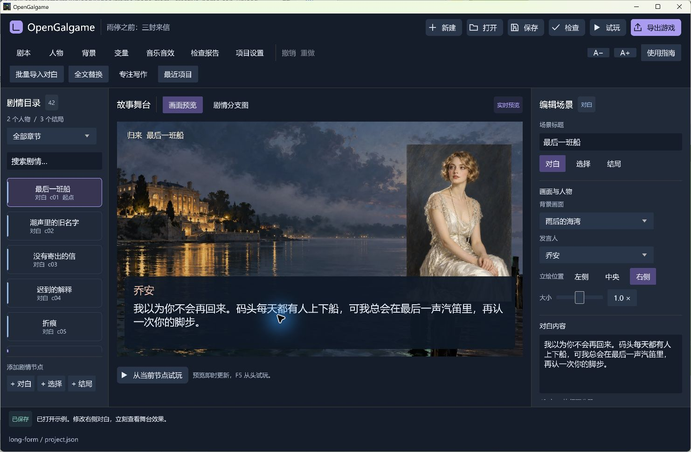

<p align="center">
  
</p>

<p align="center">
  <a href="https://github.com/eveque-dev/opengalgame/releases/latest"></a>
  <a href="https://github.com/eveque-dev/opengalgame/actions/workflows/windows.yml"></a>
  
  <a href="LICENSE"></a>
</p>

<p align="center">
  <strong>写下对白。连接选择。让故事真正运行。</strong><br>
  Rust 原生视觉小说引擎与可视化编辑器，为 Windows 创作者提供从剧本到独立游戏的完整工作流。
</p>

<p align="center">
  <a href="https://github.com/eveque-dev/opengalgame/releases/latest"><strong>下载编辑器</strong></a> ·
  <a href="docs/guide.zh-CN.md">使用指南</a> ·
  <a href="examples/long-form/project.json">查看示例剧本</a> ·
  <a href="docs/architecture.md">引擎架构</a>
</p>

---



### 把创作留在画面里

OpenGalgame 把人物、背景、对白和选择放在同一个工作区。你可以逐段写作，也可以整段导入剧本；在分支图里连接选择，在舞台上立即查看演出。项目可离线编辑，导出的游戏可以独立运行。

| 写故事 | 组织分支 | 完成演出 |
| :--- | :--- | :--- |
| 批量对白导入、章节筛选、全文查找替换、专注写作 | 端口拖线、条件选项、布尔变量、断链与循环提示 | 多人物同屏、表情组、立绘布局、淡入淡出与滑入 |
| **管理素材** | **随时试玩** | **交付作品** |
| 背景缩略图、人物标签、引用计数、替换与移除提示 | 编辑与成品共用舞台和运行内核，路线高亮、回退与变量恢复 | 标题菜单、音乐音效、截图存档、结局收藏、自定义图标 |

### 看清每一次选择


连线决定去向，条件决定哪些选择会出现。试玩时，分支图保留当前路线，方便核对剧情；检查报告会定位缺失素材、断开的目标、不可达节点和条件导致的死路。

### 写作时，留一点安静


专注模式隐藏左右面板，保留章节、发言人和正文。Ctrl+S 正式保存，Ctrl+Z 撤销；每 30 秒的独立恢复副本，为意外退出后的继续写作保留机会。

### 下载，解压，开始创作

前往 **[Releases](https://github.com/eveque-dev/opengalgame/releases/latest)**，选择适合你的文件：

| 文件 | 用途 |
| :--- | :--- |
| `opengalgame-v0.2.0-windows-x64.zip` | **推荐。** 便携编辑器，附完整样例和许可文件；解压后双击 `opengalgame.exe` |
| `three-letters-v0.2.0-windows-x64.zip` | 已导出的三结局游戏，解压后双击 `Game.exe` 体验 |
| `opengalgame-v0.2.0-source.zip` | 源码、锁定依赖、样例、测试与打包工具 |
| `opengalgame.exe` | 编辑器单文件，需现有项目，以 `--editor project.json` 启动；首次体验请下载完整便携包 |

玩家和便携版使用者无需安装 Rust、Python 或 WebView。目标平台为 **Windows 10/11 x64**，需要正常的 OpenGL 3.3 图形驱动。

```text
新建项目 → 导入人物与背景 → 编写对白 → 连接选择 → 试玩与检查 → 导出游戏
```

分享时发送整个导出目录，保留 `Game.exe`、`game.json`、`assets/` 与许可文件。详细操作见 [中文使用指南](docs/guide.zh-CN.md)。

### 从开场，走向三种明天


内附原创验收故事 **《雨停之前：三封来信》**：42 个节点、3 个结局、10 条完整选择路径。留下、远行，或追问一封信背后的真相，用实际故事检验条件分支、变量和存档。

另有 8 节点入门样例。示例表情组复用默认立绘，可导入自己的表情图片替换；音乐与提示音为程序合成。

### 一个可以读懂、修改的内核

OpenGalgame 使用 **Rust + egui/eframe** 构建原生桌面界面。项目以 UTF-8 JSON 保存，剧情、运行、编辑和导出各有明确的模块边界。

```text
人物 / 背景 / 对白 / 选择
           │
    可视化编辑与项目校验
           │
      共用剧情运行内核
        ┌──┴──┐
      内嵌试玩  独立 Game.exe
```

Windows 开发环境需要 Rust MSVC、Visual Studio C++ Build Tools 与 Windows SDK：

```powershell
git clone git@github.com:eveque-dev/opengalgame.git
cd opengalgame
cargo run --locked
```

```powershell
cargo test --locked
cargo fmt --check
cargo clippy --all-targets --locked -- -D warnings
cargo build --release --locked
python tools/package_windows.py
```

支持命令行校验、运行与导出，参见 [开发与架构](docs/architecture.md)。

### 可核对的质量，而非空白的承诺

当前包含 **21 项自动测试**，覆盖条件分支、变量回退、存档匹配、事务式导入、恢复副本、媒体迁移与真实 EXE 图标资源。42 节点样例的 10 条路径在保存、重开与导出后重复验证。

原生窗口也完成了从开场到结局的实际游玩，以及拖线、工程恢复、自动阅读暂停、截图存档与结局收藏检查。验证范围和限制见 [验收记录](docs/validation.md)。

### 当前边界

这是持续开发中的 **0.2 版本**。目前专注 Windows 原生创作与播放，尚不提供 Ren’Py `.rpy` 导入、任意脚本插件、配音时间轴或跨平台导出。旧项目内容发生变化后，旧存档可能因指纹不同而被拒绝读取。恢复副本不能保证保留意外退出前最后 30 秒的编辑。

欢迎提交可复现的问题与具体改进建议，见 [贡献指南](CONTRIBUTING.md)。

---

代码采用 [MIT License](LICENSE)。第三方组件遵循各自许可，发布包保留相关声明。示例美术为此前生成的演示素材；创作自己的作品时，请使用有权使用的素材。详见 [素材与组件说明](THIRD_PARTY.md)。

<p align="center"><sub>OpenGalgame · Built with Rust, made for stories.</sub></p>
