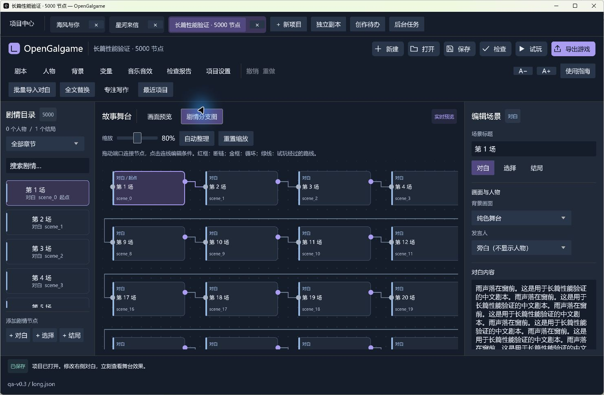

# 长篇性能记录

0.3 的数据样例包含 5000 个节点、50 章、约 230 万字中文正文，紧凑项目 JSON 约 8.44 MB，无图片和音频。它用于观察长篇数据结构，不代表所有游戏的帧率。

```powershell
cargo run --release --locked --example performance
# 可选：生成可用编辑器打开的 JSON
cargo run --release --locked --example performance -- reports/performance-project.json
```

本机 Windows x64 release 构建的一次记录：

| 操作 | 耗时 |
| --- | ---: |
| 解析项目 JSON | 16.6 ms |
| 结构与条件校验 | 5.9 ms |
| 100000 次按节点标识查找 | 7.8 ms |
| 100 次撤销快照及单节点编辑 | 2.6 ms |
| 5000 节点循环检测 | 2.1 ms |
| 500 步回退历史的兼容清单及存档序列化 | 0.43 ms |

最后一次单节点编辑后，5000 个节点中有 4999 个仍与上一份快照共享；100 次编辑后有 4900 个与原工程共享。实际使用 `Arc::make_mut`，没有把每份快照的所有对白重新复制。存档约 48 KB，计时使用试玩开始时缓存的完整指纹。

这些数值不包含磁盘等待、初始完整指纹计算、图片解码、音频、GPU 渲染和交互帧率；硬件、系统负载、变量与分支数量会改变结果。条件检查最多遍历 8192 个状态，超过会显示提示，不宣称穷举所有复杂项目。

## UI 与后台工作



- 剧情目录与目标选择按可见行生成控件；搜索结果、节点目标、循环检测按修改版本更新。
- 分支图只绘制可见节点、端口和相关连线。图的尺寸与连线遍历仍随节点数增长，不宣称整个图编辑是常数复杂度。
- 单项目 GPU 图片缓存预算 96 MiB/160 项；舞台纹理最长边 2048、缩略图 512。解码在线程内执行并设置尺寸和分配限制。预算不包含图形驱动、解码临时内存及其他应用占用。
- 切换项目释放非活动项目纹理，保留轻量工程、编辑和试玩状态；图片请求队列有界。
- 工程读取、恢复副本序列化、游戏导出后台执行。正式保存仍同步进行，重要保存提供明确完成状态。

实测范围和原生交互记录见 [验证记录](validation.md)。
